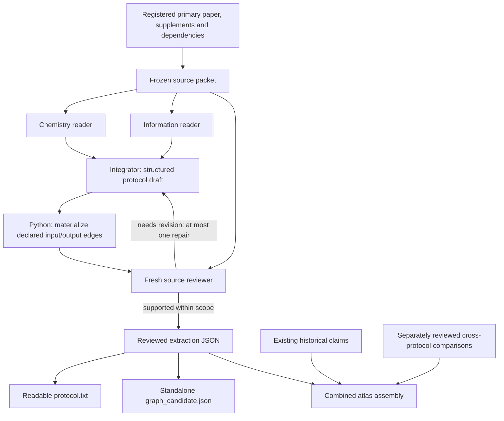

# Sequencing Technology Atlas

A research harness for turning published sequencing methods into source-linked
protocol graphs, then connecting technologies through separately supported
historical relationships and contextual protocol comparisons.

**Current stage: a working development snapshot for discussion and evaluation
before large-scale extraction.** The atlas is not fully decomposed, and the
extractions have model/source reviews rather than expert or experimental validation.

## Start here

| Question | Read / run |
| --- | --- |
| What have we built, and what remains undecided? | [Current status and pre-batch decisions](docs/STATUS.md) |
| What exactly does an agent extract? | [Output fields and their connections](docs/OUTPUT_FORMAT.md) |
| How do the agents and Python code work together? | [Pipeline and code map](docs/PIPELINE.md) |
| Can I inspect a real extraction? | [ChIPmentation example](examples/chipmentation/README.md) |
| How do methods enter the larger graph? | [Graph layers and agent tools](docs/GRAPH.md) |
| How do we run and evaluate the next batch? | [Runbook](docs/RUNBOOK.md) and [evaluation plan](docs/EVALUATION.md) |
| Where did this code come from? | [Provenance and references](docs/PROVENANCE.md) |

## Run locally without a model

From a checkout, using Python 3.13 and `uv`:

```sh
uv sync --python 3.13 --extra dev
uv run python scripts/check_example.py
uv run python scripts/inspect_example.py --operation o_tag_v1
uv run pytest -q
```

These commands validate the distributed example's structure and archived review
binding, display one operation with its module and typed connections, and run the
software tests. They do not make model calls or re-review the paper.

The packaged snapshot passed **868 software tests** in a clean Python 3.13
environment. See the [release checks](provenance/release_checks.json) for the exact
checks and their limits.

## The pipeline



The integrator writes the descriptions and declares the relationships. Python
checks the structure, references and quotations, and renders the records. Scientific
support is judged by a separate model reviewer. A valid quotation is not proof
that the interpretation is correct.

## What exists in the local development atlas

The recorded snapshot contains **201 technology nodes**, **15 detailed workflow
records**, **578 operations**, **109 modules**, and **8 cross-protocol comparison
records**. The workflows retain **224 gap records**, which may overlap and have
different scopes and consequences. Counts describe stored records, not measured
accuracy or completeness. See the [machine-readable snapshot summary](provenance/atlas_snapshot_summary.json).

This repository distributes the relevant code, selected tests, versioned extraction
instructions, and one real extraction/review example. The full atlas, cached papers,
native transcripts and accumulated experiment directories remain in the local
research workspace. The example's limitations are explicit in its README.

## Scope of this repository

The target is a general description of a specified published assay implementation:
material/data states, actions, interfaces, required resources, information handling,
evidence and meaningful unknowns. A module is a local grouping of operations; it is
not assumed to be a universally interchangeable biochemical primitive.

The eventual purpose is to let research agents retrieve relevant transformations,
inspect their surrounding requirements, compare design changes and trace claims to
sources when proposing new sequencing technologies. The present repository does
not establish that access to this graph improves invention. That needs a separate
evaluation.

Use the [pre-batch checklist](docs/STATUS.md#decisions-before-a-large-extraction-job)
to discuss readiness. No large extraction job is launched by installing or testing
this repository.
