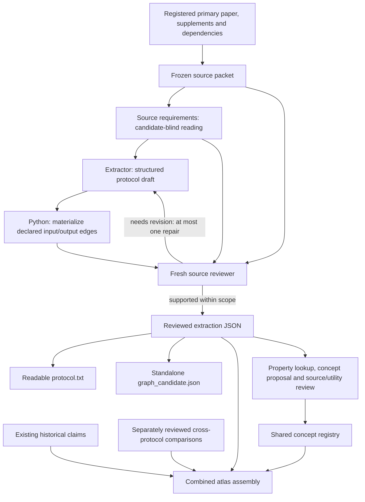

# Sequencing Technology Atlas

A research harness for turning published sequencing methods into source-linked
protocol graphs, then connecting technologies through separately supported
historical relationships and contextual protocol comparisons.

**Current stage: shared-operation alignment development, 2026-10-20.**
The new [protocol reference benchmark](benchmarks/protocol_graph_v1/README.md)
defines 12 cases across six technology strata, permits different valid graph
decompositions, and separates source collection, extraction and cross-method claims.
The latest curation runtime passed **2,019 software tests, 3 skipped** locally
and **2,014 tests, 8 skipped** on Qiu Linux.
It preserves known requirements and consequential unknowns separately, archives
every bounded graph-correction round, and blocks explicitly unsupported assertions
from positive graph/comparison results. Initial Qiu CPU pilot **48612064** and
subsequent frozen runs retain their own source, prompt and review artifacts;
no completed expert-adjudicated benchmark or scientific accuracy result is claimed
by these software checks. See
[the preregistered decisions](docs/decisions/2026-10-20-protocol-reference-benchmark.md).
Source registration and a prepare-only run now pass for **9 methods covering all
six sampling strata**. Three source-blocked cases remain in the denominator.
Construction job **48625045** finished with scheduler state `FAILED`, exit `1:0`,
after **04:28:38**. It produced nine annotations: seven passed reference review;
six graphs remain `graph_uncertain`, two references need revision (Drop-seq and
sci-RNA-seq), and the SPLiT-seq graph constructor ended in a transport timeout.
All final target checks in the six reviewed graphs were marked supported, but
blocking gaps prevent strict acceptance. There are **0 strictly accepted graphs
and 0 annotated comparisons out of eight planned questions**. These are
model-reviewed construction diagnostics, not expert gold or blind harness accuracy.
The [completion audit](docs/benchmark/audits/20261020-nine-method-construction.md)
and [completion receipt](provenance/protocol_reference_completion_20261020.json)
separate retained uncertainty from unavailable source-packet replay in the original
report. The run's frozen `7e670fd` runtime and historical artifacts remain unchanged;
[the submission receipt](provenance/protocol_benchmark_originals_submission_20261020.json)
records its inputs and software checks. See also
[the optional original-document input contract](docs/benchmark/READING_A_CASE.md).

The inventory accounts for 201 methods; protocol decomposition remains partial.
The new development checkpoint passed **1,589 software tests, 3 skipped**, plus six
experiment-only subprocess checks. It adds source-bound comparison profiles and
optional semantic registry retrieval while preserving each method's own graph.
[Tool commands and limits](docs/COMPARISON_PROFILES.md),
[19 design decisions](docs/decisions/2026-10-20-shared-operation-alignment.md), and
[pinned reference implementations](docs/REFERENCE_IMPLEMENTATIONS.json) are tracked
with the code. Similarity does not admit a shared component or a historical edge.

The complete Qiu Linux check also passed **1,584 tests, 8 skipped**. Native Qiu
job **48603557 completed in 20 minutes**: four fresh `gpt-6.1-sol` / `xhigh`
sessions produced two comparison profiles, then compiled and independently reviewed
**one shared-purpose definition with two memberships** in an isolated registry.
The example links DNA fragmentation and sequencing-adapter introduction across
ChIPmentation and Drop-seq; it asserts no whole-unit mechanism identity,
interchangeability or ancestry. [Exact prompts, outputs and interpretation](examples/semantic_alignment_pilot/native_result/README.md)
are preserved, alongside two earlier environment failures. This is a two-method
development check, not an atlas-wide accuracy or invention benchmark. The active
default remains the earlier frozen `targeted_selection_18` runtime.
Earlier extractions, graph publications and live controls remain preserved in
[current status](docs/STATUS.md). See also
[what extraction and matching must establish](docs/EXTRACTION_SCOPE_AND_MATCHING.md).

## Start here

| Question | Read / run |
| --- | --- |
| How do I prepare, run, resume and publish a full inventory? | [Deployment workflow](docs/DEPLOYMENT.md) |
| How are missing papers found and registered? | [Public source acquisition](docs/SOURCE_ACQUISITION.md) |
| What have we built, and what remains undecided? | [Current status and pre-batch decisions](docs/STATUS.md) |
| What exactly does an agent extract? | [Output fields and their connections](docs/OUTPUT_FORMAT.md) |
| How will we assess extraction without requiring one exact graph? | [Protocol benchmark](benchmarks/protocol_graph_v1/README.md) and [reading one case](docs/benchmark/READING_A_CASE.md) |
| Why can a valid citation still accompany an unsupported claim? | [Observed failures, source-entailment research and proposed controls](docs/decisions/2026-10-20-source-entailment-and-unsupported-additions.md) |
| How do the agents and Python code work together? | [Pipeline and code map](docs/PIPELINE.md) |
| Can I inspect a real extraction? | [ChIPmentation example](examples/chipmentation/README.md) |
| How do methods enter the larger graph? | [Graph layers and agent tools](docs/GRAPH.md) |
| How can agents reuse operation/module labels? | [Shared concept registry](docs/CONCEPT_REGISTRY.md) |
| How can workers propose definitions concurrently? | [Pending proposals, comparisons and coordinated admission](docs/CONCEPT_REGISTRY.md#shared-proposals-and-coordinated-admission) |
| What happened when ten paper jobs ran concurrently? | [Ten-paper results, failures and corrections](docs/TEN_PAPER_DIAGNOSTIC.md) |
| Can the system connect methods with a known shared reaction? | [Three-method experiment and source-backed recovery of independent definitions](docs/KNOWN_OVERLAP_EXPERIMENT.md) |
| How do we find common operations while preserving different assay architectures? | [Shared-operation discovery and broad workflow roles](docs/SHARED_OPERATIONS.md) |
| How do we describe States/Operations for comparison and use semantic registry search? | [Comparison profiles, tool commands and admission boundaries](docs/COMPARISON_PROFILES.md) |
| Why were these representation and matching choices made? | [Decision record](docs/decisions/2026-10-20-shared-operation-alignment.md) and [pinned reference implementations](docs/REFERENCE_IMPLEMENTATIONS.json) |
| Can workers match a frozen vocabulary consistently without creating new labels? | [Real-paper frozen-matching pilot](examples/frozen_matching/README.md) |
| How do we decide whether a shared label is useful? | [Admission policy, fields and reference audit](docs/CONCEPT_ADMISSION.md) |
| What prevents a plausible-looking definition from passing incomplete checks? | [Definition review and consistency contract](docs/BEHAVIOR_CONTRACT.md) |
| Did those checks catch deliberately incorrect scientific claims? | [Definition-review diagnostics and ordinary grouping run](examples/behavior_contract/README.md) |
| Has label admission actually run with models? | [Paired cohort test and redundant-label control](examples/concept_admission/README.md) |
| What happened on new methods and harder boundaries? | [Six-selection experiments and harness corrections](examples/concept_experiments/README.md) |
| How do we run and evaluate the next batch? | [Runbook](docs/RUNBOOK.md) and [evaluation plan](docs/EVALUATION.md) |
| Where did this code come from? | [Provenance and references](docs/PROVENANCE.md) |

## Run locally without a model

From a checkout, using Python 3.13 and `uv`:

```sh
uv sync --python 3.13 --extra dev
export PYTHONPATH="$PWD/src"
uv run python scripts/check_example.py
uv run python scripts/inspect_example.py --operation o_tag_v1
uv run pytest -q
```

These commands validate the distributed example's structure and archived review
binding, display one operation with its module and typed connections, and run the
software tests. They do not make model calls or re-review the paper.
The explicit source path makes these checkout commands independent of editable-install
path-file behavior. Run them from the repository root.

The [status record](docs/STATUS.md) separates software checks, live model runs
and scientific limitations. Earlier experiment results remain linked there;
test counts are not evidence of scientific accuracy.

Shared-operation matching has two modes. Routine workers compare against a
frozen vocabulary. Separate curation jobs can propose definitions and reconcile
parallel proposals through source review and coordinated admission. See the
[registry workflow](docs/CONCEPT_REGISTRY.md#shared-proposals-and-coordinated-admission).
Neither mode equates matching names with equivalent reactions.

## The pipeline



The integrator writes the descriptions and declares the relationships. Python
checks the structure, references and quotations, and renders the records. Scientific
support is judged by a separate model reviewer. A valid quotation is not proof
that the interpretation is correct.

## Recorded atlas snapshot

The 2026-10-15 snapshot contains **201 technology nodes**, **15 detailed workflow
records**, **578 operations**, **109 modules**, and **8 cross-protocol comparison
records**. The workflows retain **224 gap records**, which may overlap and have
different scopes and consequences. Counts describe stored records, not measured
accuracy or completeness. See the [machine-readable snapshot summary](provenance/atlas_snapshot_summary.json).

This repository distributes the relevant code, selected tests, versioned extraction
instructions, and one real extraction/review example. The full atlas, cached papers,
native transcripts and accumulated experiment directories remain in the local
research workspace. The example's limitations are explicit in its README.

## Scope of this repository

The target is a general description of a specified published assay implementation:
material/data states, actions, interfaces, required resources, information handling,
evidence and meaningful unknowns. A module is a local grouping of operations; it is
not assumed to be a universally interchangeable biochemical primitive.

The eventual purpose is to let research agents retrieve relevant transformations,
inspect their surrounding requirements, compare design changes and trace claims to
sources when proposing new sequencing technologies. The present repository does
not establish that access to this graph improves invention. That needs a separate
evaluation.

Use the [deployment workflow](docs/DEPLOYMENT.md) to prepare, inspect and launch
a batch explicitly. Installing or testing this repository does not launch model jobs.
