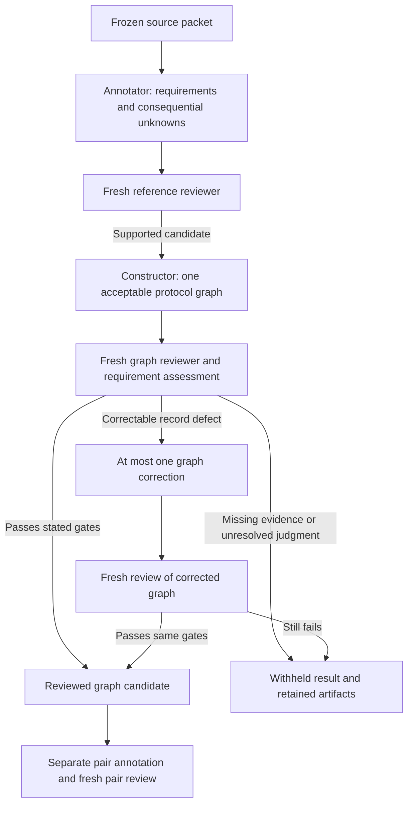

# Source-grounded protocol graph benchmark

The benchmark evaluates whether a system faithfully represents published sequencing
protocols and makes supported cross-method connections. Multiple graph decompositions
can satisfy the same scientific requirements. Invention quality is outside this task.

A complementary [graph-to-protocol track](../../docs/benchmark/GRAPH_TO_PROTOCOL.md)
tests whether a fresh agent can reconstruct readable protocol prose from the
graph alone. Its restricted input command and writer prompt are implemented;
native reconstruction and scientific scoring are not yet executed. The
source-bearing graph export must not be supplied wholesale to that writer.

The [case design](cases.json) specifies **12 methods in six sampling strata**:

| Stratum | Methods | Split |
| --- | --- | --- |
| DNA methylation conversion | RRBS (2008), scBS-seq (2014) | Development |
| Chromatin accessibility | ATAC-seq (2013), DNase-seq (Boyle 2008) | Development |
| Droplet single-cell RNA | Drop-seq, inDrop (2015) | Development |
| Combinatorial indexing RNA | sci-RNA-seq (2017), SPLiT-seq (2018) | Development |
| Spatial transcriptomics | Original Spatial Transcriptomics (2016), Slide-seq (2019) | Reserved from future tuning |
| Metabolic RNA recoding | SLAM-seq, TUC-seq (2017) | Reserved from future tuning |

Prior project exposure is recorded per case. These overlapping strata do not
constitute pristine unseen families. A prespecified TimeLapse-seq reserve is
inactive unless an explicit, recorded source-availability decision activates it.

## Outputs and their authority

1. **Frozen source packet:** exact publication, variant, registered Methods,
   supplements and dependencies, with original/rendition provenance.
2. **ProtocolReference:** scientific obligations, evidence, inclusion rationale,
   unknowns, admissible decomposition descriptions and source-grounded query cases.
3. **ReferenceReview:** exhaustive independent checks plus missing obligations;
   software computes whether the reference candidate passes its stated gate.
4. **Workflow:** one source-supported example graph, constructed after reference
   review. States, Operations, Flows and Modules use the existing extraction schema.
5. **Graph review and BenchmarkAssessment:** source support and obligation coverage
   are assessed separately; assessment 1.1 additionally checks every reference
   unknown against graph witnesses. Deterministic scoring retains every denominator.
6. **Separate cross-method cases:** scoped relationships with source-bound witnesses;
   unannotated relationships are not automatically negative examples.

Initial annotations are **model-authored, independently model-reviewed reference
candidates**, not human-validated ground truth. Graph construction from reference
answers is a self-consistency check. It is not a blind harness benchmark result.

The benchmark uses the same graph schema and assembly as production extraction;
it does not introduce a competing protocol format. The
[contract audit](../../docs/benchmark/audits/20261020-benchmark-production-contract.md)
separates format compatibility from scientific acceptance and production provenance.
Any future representation change needs corresponding extraction instructions,
schema/assembly checks and a versioned migration before it becomes a benchmark
requirement. Existing archived records keep their original meaning and hashes.



Every graph round remains archived. Correction does not change the source packet,
reference requirements or acceptance criteria. The report distinguishes the
selected round and correction count instead of presenting a corrected result as
first-pass success. See the [bounded correction decision](../../docs/decisions/2026-10-20-bounded-graph-correction.md).

Schema/hash/quote checks do not establish entailment. See
[the decisions and alternatives](../../docs/decisions/2026-10-20-protocol-reference-benchmark.md)
and [primary paper/code audit](../../docs/benchmark/REFERENCE_AUDIT.md).
[Read one case](../../docs/benchmark/READING_A_CASE.md) explains the exact artifacts,
their fields and their authority. The [uncertainty accounting decision](../../docs/decisions/2026-10-20-benchmark-unknown-preservation.md)
and [source-recovery decision](../../docs/decisions/2026-10-20-benchmark-source-recovery.md)
record the general changes exposed by the first construction run.

## Inspect schemas without models

From the repository root:

```sh
PYTHONPATH=src .venv/bin/python -m genomics_discovery.curation.protocol_benchmark schema reference
PYTHONPATH=src .venv/bin/python -m genomics_discovery.curation.protocol_benchmark schema review
PYTHONPATH=src .venv/bin/python -m genomics_discovery.curation.protocol_benchmark schema assessment
PYTHONPATH=src .venv/bin/python -m genomics_discovery.curation.protocol_benchmark schema assessment-v2
```

All native source finding and annotation execute in bounded Qiu Sherlock Slurm
jobs with `gpt-6.1-sol`, `xhigh`. Existing frozen runtimes, historical papers and
accepted atlas records are not overwritten.

`scripts/benchmark/run_recovered_qiu.sbatch` runs the retained-source recovery,
reference construction, eligible pair review and offline report as one bounded
phase. `scripts/benchmark/report.py` reports all 12 selected cases, six strata
and eight pair questions, including withheld and unassessed cases. Missing source
access is not scored as an extraction error, and declared factual-audit rows are
not promoted to whole-graph precision. Legacy assessment 1.0 remains 1.0.
