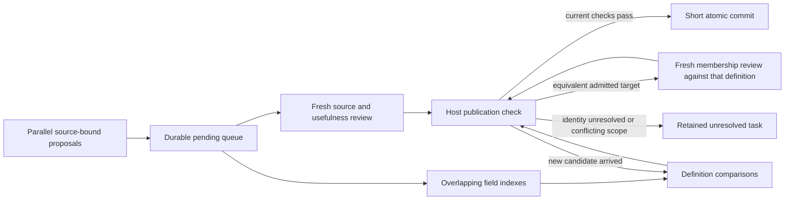

# Reusing labels without merging protocols

Decision recorded 2026-10-16. This is an indexing layer after extraction: the
source protocol still determines the operations and their local module boundaries.

The subsequent [admission policy](CONCEPT_ADMISSION.md) separates factual support
from the usefulness of creating a shared concept. Current writes require both.
The first three-job pilot predates this policy and is retained as historical evidence.

## Contract and alternatives

A concept has a stable ID, preferred name, alternative names, a full transformation
definition and a scope note. A use of that concept points to an exact, connected
selection of operations in a versioned workflow. Selections can span local modules;
an operation or selection can have several concepts. A new concept can start with
one documented use. We do not require that two existing technologies share it.

The host must preserve source/review bindings, reject stale registry updates and
prevent an existing ID from silently acquiring a different definition. Search
returns candidates, not an identity judgment. An agent proposes reuse or a new
definition and a separate reviewer assesses both source membership and catalogue
utility. Properties-only and provisional decisions retain the selected operation
without adding a shared concept.

Rejected alternatives: same string means same operation (polysemy and context
loss); independently invented tags in every extraction (duplicates and drift);
exhaustive pairwise matching before indexing (unnecessary). Shared labels narrow
future comparisons; they do not replace comparison of ordering and interfaces.

## Reference audit

We adopt the separation of concept identity, preferred/alternative labels and scope
notes from [W3C SKOS, 2009 Recommendation](https://www.w3.org/TR/2009/REC-skos-reference-20090818/).
The executable vocabulary in [RDFLib 7.1.4, `_SKOS.py`](https://github.com/RDFLib/rdflib/blob/7.1.4/rdflib/namespace/_SKOS.py)
exposes those as different properties. It also distinguishes nontransitive
`closeMatch` from transitive `exactMatch`. We do not adopt `exactMatch` as assay
interchangeability and do not add transitive scientific inference.

The independent [OLS4 implementation](https://github.com/EBISPOT/ols4/tree/faca50536774a359e5892b437f97367a0e4833f5)
provides terminology search rather than experimental compatibility checks.
Its `backend/src/main/java/uk/ac/ebi/spot/ols/repository/search/OlsSearchQuery.java`
separates text search and exact-match handling. Search and terminology identity
are useful precedents; neither establishes that a protocol meets a definition.
No third-party source code is copied; no RDF/OLS service dependency is introduced.

Our adaptation retains the existing `TransformationDefinition`, source-backed
connected cuts, and membership review gate. Substrate, transformation, output,
information effect and context remain explicit natural-language descriptions.
Machine validation checks their bindings; source review judges their meaning.

## Required tests and limits

Test lookup/reuse/new, negative and unresolved review, duplicate label collisions,
parallel stale writes, changed definitions, changed sources and selections,
multiple concepts per selection, and source-preserving graph projection. Synthetic
tests cannot measure semantic precision. A real-paper pilot must examine false
merges, missed reuse, and unjustified splitting across dissimilar assay families.
The label registry is not a claim that all biology fits a fixed primitive taxonomy.

## What now runs

The code is in `src/genomics_discovery/curation/operation_registry/`:

- `models.py`: one source-bound assignment, existing definition fields, aliases,
  scope note, reuse/new decision, and a declared search history.
- `admission.py`: competency question, property-filter alternative, example
  boundaries, revision requests and separate source/utility judgments.
- `commit.py`: atomic cohort commits; only decisions passing both gates add labels.
  All decisions, including non-admissions, retain their source-bound selections.
- `store.py`: candidate lookup, immutable definitions, reviewed uses, and SQLite
  transactions. The host reruns recorded queries; agent-authored hit lists are not
  accepted. This verifies query results, not the agent's reasoning or search recall.
- `prompts.py`: the exact compiler and reviewer instructions.
- `integrity.py`: detect changed archived definitions, selections or reviews before
  reading/exporting the registry. This checks bindings, not fresh scientific support.
- `__main__.py`: JSON-producing tools for agents and the host.
- `selections.py`: bounded access and field-specific search across the actual
  selected operations; properties can be retrieved without shared labels.
- `graph.py`: join label selections to existing graph nodes by workflow/source
  hashes and operation IDs. No connections are inferred from display names.
- `playground/workflow_concepts_live.py --curate`: a compiler session followed by a fresh
  reviewer session, using the existing native worker and archive checks. Only the
  host commits admitted assignments. All valid decisions remain in the registry
  ledger; incomplete/invalid attempts remain in the run directory. No automatic
  retries or modification of protocols occurs. One job can consider a cohort of
  selections together, using the same frozen catalogue throughout.

The shared catalogue contains definitions and aliases only, not accumulated
papers, extracted operations, or previous reviewer opinions. Sources are reopened
in bounded passages with the existing extraction tools. The complete contextual
use and review remain in the local database/run archive.

## Run after extracting a method

From the repository root, after installing the project:

```sh
export PYTHONPATH="$PWD/src"
mkdir -p runs outputs
uv run atlas-concepts init runs/concepts.sqlite
uv run atlas-concepts prepare WORKFLOW.json PACKET.json OPERATION_ID \
  --review REVIEW.json --output runs/selected-operation
uv run python -m playground.workflow_concepts_live \
  runs/selected-operation/manifest.json runs/concepts.sqlite runs/label-job \
  --model gpt-6.1-sol --effort xhigh --curate
uv run atlas-concepts snapshot runs/concepts.sqlite > outputs/catalogue.json
uv run atlas-concepts lookup outputs/catalogue.json 'substrate transformation output'
uv run atlas-concepts inspect outputs/catalogue.json CONCEPT_ID
uv run atlas-concepts uses runs/concepts.sqlite CONCEPT_ID --offset 0 --limit 10
uv run atlas-concepts decisions runs/concepts.sqlite --status provisional
```

`prepare` accepts several operation IDs, or `--module MODULE_ID` to select that
module's operations. The selection must have real material/data/control connectivity;
sharing a module name or reported precedence does not establish one transformation.
Each job makes one decision per supplied selection and assigns at most one concept
to each. A later job can assign a different concept to the same selection. Combine
prepared manifest entries to consider a cohort in one job. Extraction itself does not
consult the registry, so existing labels cannot silently determine what is extracted.

`reuse` copies the existing definition, aliases, scope and relation unchanged.
`new` proposes a full definition and explains the distinction from inspected
candidates. A fresh source review and utility review must support either assignment. One documented
use can establish the initial entry; this does not demonstrate reuse elsewhere.
An operation whose input cannot be stated remains outside this whole-transformation
index without becoming an invalid protocol record.

Lookup currently ranks literal words in definitions and aliases. It is an initial
candidate generator, not a validated semantic retrieval model. Synonyms absent
from the registry can be missed. Matching names never assign labels automatically.
Preferred-name collisions require disambiguation; aliases may be ambiguous and
return multiple candidates. Different concepts can overlap.

## Find reviewed components inside a larger module

```sh
uv run atlas-concepts in-region outputs/catalogue.json WORKFLOW.json --module MODULE_ID
uv run atlas-concepts in-region outputs/catalogue.json WORKFLOW.json OPERATION_ID_1 OPERATION_ID_2
```

This read-only query returns previously admitted component occurrences whose entire
operation set falls inside the requested region. It also reports occurrences that
cross the region boundary, including the operation IDs outside it. It binds to the
exact workflow content hash; matching operation names in a changed workflow cannot
reuse the archived mapping.

The response retains each component's definition, relation, exact operations,
inputs, outputs, requirements, source-packet hash and mapping-review hash. It makes
zero new mapping assertions and does not reopen the source documents. A larger
module containing a tagmentation occurrence does not become equivalent to the
tagmentation concept. No recorded occurrence does not establish that no such
component exists. The implementation is `operation_registry/regions.py`.

The Qiu development check located existing reviewed tagmentation occurrences in
preserved ATAC-seq, ChIPmentation and Smart-seq2 workflows, and the existing DNA
purification occurrence in ATAC-seq. This exercises navigation over archived
assignments; it is not a new scientific match or an automatic boundary-discovery
evaluation.

## Retrieve regions for a known definition

Open unit discovery and retrieval for an existing definition are separate tasks.
The former can return a useful large library-preparation block; the latter must
locate the requested transformation inside it. In the Qiu development check, open
discovery selected three larger units and missed both known narrow boundaries.
Definition-targeted retrieval recovered both and proposed an additional analytical
cleanup occurrence. Two fresh assessments supported three candidate memberships,
but the experiment admitted zero canonical assignments.

`playground.workflow_unit_selection_live.execute` accepts optional `targets=Path(...)`.
The file has `format_version: "unit_selection_targets/1.0"` and a nonempty
`definitions` list using the existing complete `TransformationDefinition` fields.
These are retrieval questions, not asserted matches. Duplicate IDs and extra
opinion fields are rejected. Original query bytes and a normalized snapshot are
pinned; changed inputs invalidate completion. Omitting `targets` retains open unit
discovery. The candidate-cut output and separate membership/admission gates are
unchanged.

From the repository in a Sherlock Slurm allocation, the API is:

```python
from pathlib import Path
from genomics_discovery.curation.codex_worker import CodexWorker
from playground.workflow_unit_selection_live import execute

state = await execute(
    Path("parents.json"), Path("runs/target-retrieval"),
    targets=Path("targets.json"),
    worker=CodexWorker(model="gpt-6.1-sol", effort="xhigh",
                       web_search=False, network_access=False),
)
```

The prompt-only CLI also accepts `--targets` on
`python -m playground.workflow_unit_selection prompt`. A selection can span several
operations or overlap other selections. It cannot split the interior of an
already-coarse operation; such cases need a source-backed workflow refinement.
Neither notes about unlocated targets nor the diagnostic four-cut sampling limit
establish exhaustive search. This pilot does not establish family-wide accuracy.

## Parallel jobs and graph integration

The direct `--curate` path retains its conservative stale-snapshot behavior.
SQLite serializes host writes. Within a cohort, identical new definitions can be
assigned to several selections in one atomic commit. Conflicting definitions or
duplicate proposed concepts roll back the whole commit. Creating a concept against an outdated snapshot
stops for reconciliation; it cannot overwrite another agent's entry. Reviewed
reuse can commit after unrelated additions if the referenced definition is still
identical. Its original review binding remains visible. Conflicting new-concept
proposals need reconciliation; the new `--shared` path below supplies that queue.
There is no silent automatic merge, relabeling, broadening or deletion in v1.

```sh
uv run atlas-concepts export-graph runs/concepts.sqlite > outputs/concept-overlay.json
uv run atlas-concepts attach runs/concepts.sqlite EXISTING_ATLAS.json \
  > outputs/atlas-with-concepts.json
uv run atlas-graph neighbors outputs/atlas-with-concepts.json concept:CONCEPT_ID \
  --layer concept
```

The integrated route is `concept <- instance_of_concept - selection
-> selects_operation -> original operation`. It can represent one or several
operations and retains their original local module IDs. Assignments to the same
concept create retrieval neighbors, not historical or substitution edges.
All assigned workflow/source versions must exist exactly in the target atlas.
The original atlas stays unchanged; output pins the database and base atlas.
Changing either invalidates that assembled version until explicitly rebuilt.

## Routine matching with a frozen vocabulary

The live driver's default is now **read-only matching**, not label admission.
Omit `--curate` to run two fresh, independently instructed assessments against the
same frozen catalogue. The host enumerates all selection/concept pairs in this
small-catalogue pilot and requires checks for all seven existing definition fields.
An explicit contradiction gives non-membership; missing support gives unknown;
only fully supported criteria give membership. The paired reports must agree for
a positive candidate. A new-definition request stays in `pending_extensions.json`.
No registry entries, memberships or atlas edges are written in this mode.

Tools: `matching-plan SNAPSHOT MANIFEST`, `schema matching`, and
`check-matching SNAPSHOT PLAN MANIFEST [REPORT]`. The latter verifies exact pair
and criterion coverage, source quotations, declared inspected passages and frozen
input bindings. It does not establish scientific entailment. The readonly default
is an entry-point policy, not an OS-level prohibition against malicious file access.
The runtime checks source/code bindings and registry changes. Reviewer blinding is
instructed; the worker's filesystem sandbox does not hide earlier attempt files.

Artifacts are `plan.json`, two attempt `artifact.json` reports,
`matching_results.json`, `pending_extensions.json`, and the existing native prompt,
event, state and binding records. The result identifies exact operation selections
through the plan and manifest. Extensions still require a separate curation run
with fresh source/utility review; this is not an automatic promotion path.

The exhaustive candidate list is deliberate for this pilot: it isolates matching
from retrieval misses. It is not a scaling strategy for a large vocabulary.
Use `scripts/check_frozen_runs.py LEFT_RUN RIGHT_RUN --output REPORT.json` to compare
presentation-order runs by stable selection/concept IDs. Agreement is a consistency
diagnostic, not an accuracy measurement. Frozen selection boundaries remain inputs;
automatic choice of boundaries is not solved by this change.

Manual `apply` now requires `--admission-decision` and `--admission-review` as well
as the original source review. `apply-vocabulary` accepts an entire cohort proposal
and review. Both perform source/binding/utility-gate validation but cannot
prove a separate agent authored them. Such commits are marked accordingly. The
live driver checks distinct completed native threads and records archive paths.
Neither path establishes scientific correctness by itself.

## Pilot and remaining decisions

The initial [three-job live pilot](../examples/concept_registry/README.md) created two
contextual definitions and reused one on a second protocol variant. The results
include actual definitions, source identities, review rationales and latency.
Its implementation passed 895 software tests, including 27 registry/driver checks.

This establishes working lookup, reviewed assignment and graph navigation. It
does not establish the best abstraction level. Definitions that are too narrow
may obscure useful shared mechanisms; overly broad definitions may hide important
interfaces. Evaluate this on dissimilar families before prescribing a taxonomy.
Multiple labels and connected multi-operation selections are supported; the pilot
does not yet establish their scientific reliability.

The v1 store keeps one JSON snapshot in SQLite for atomic commits. It is intended
for this development pilot, not a measured high-throughput service. Lookup recall,
snapshot growth, new-concept reconciliation and selection of which operation
groups to label remain scale-up work. A label registry does not itself choose the
most informative groups. The live driver records file/code/artifact bindings and
exact prompts; these are local archives, not automatically portable replay bundles.

Legacy entries remain readable and are explicitly `legacy_unassessed` for utility.
New graph projections include only admitted assignments. Re-reviewing a legacy use
creates a new record with an explicit predecessor link; original evidence and
reviews remain unchanged. Changing a concept's definition requires a new ID and
fresh membership review; a revision request alone changes nothing.

## Shared proposals and coordinated admission

The vocabulary defines **comparison concepts for whole transformations**, not a
fixed list of universal assay stages. Each definition records substrate, operation,
physical mechanism (or an explicit unknown), output, information effect, purpose
and context requirements. Names and aliases are display/search aids. A reviewed
use points to exact operations in an unchanged source workflow. Multiple concepts
can describe the same selection in separate assignments.

For example, a Tn5 fragmentation/tagging concept can connect source-backed uses in
different assays while their bead attachment, enrichment, buffers and downstream
handling remain properties of those uses. It cannot establish that the recipes
are interchangeable. Module names are not the identity key.



What happens in order:

1. A worker captures a catalogue and submits a source-bound proposal. Pending
   definitions immediately become searchable by other jobs. Source reviews run
   outside database transactions.
2. Candidate lookup unions separate indexes for the seven fields, labels, and
   combined definition text. A definition can appear through several routes.
   There are no mutually exclusive chemistry/sample-preparation buckets.
3. A comparison worker assesses all seven fields plus scope and relation. The
   host derives equivalent, broader, narrower, overlap, distinct, non-equivalent
   with incomplete characterization, or unresolved. A known separating field
   rules out whole-definition equivalence even if another field is unknown;
   the unknown field remains recorded. Neither negative outcome proves disjointness.
   Same word or same enzyme never suffices. Exact definition-pair decisions can
   be reused in either direction; contradictory reports become unresolved.
4. Before publication, the host rechecks current candidates and source bindings.
   A newly arrived relevant definition requires its missing comparison. It does
   not automatically invalidate the previous paper review.
5. If a canonical equivalent has been admitted, a revised proposal must receive
   a **fresh source/utility review against that definition**. The old positive
   verdict cannot be transplanted. Broader/narrower overlap instead requests
   reconsideration of whether existing definitions plus properties suffice.
6. A brief write transaction checks that no intervening write occurred and
   publishes the validated records. On a race, the host repeats its checks;
   it never calls a model while holding the database lock.

The database now stores definitions, uses, decisions, submissions and comparison
reports in separate rows. SQLite still has one writer: this implementation
parallelizes the expensive research/review work, not database writes. We have
not measured a throughput benefit from sharding and do not claim row-level locks.
Legacy databases remain readable; migration creates a new database and preserves
the original. Uncommitted drafts can be explicitly withdrawn with a reason while
retaining their evidence and reviews.

Source eligibility is tracked per decision, including mixed cohorts. Rejected
definitions leave the active candidate set while their immutable proposals and
in-flight comparisons remain auditable. Current label-collision checks apply only
to decisions being admitted. All source evidence still undergoes validation.

Concurrent workers reserve unordered definition-pair hashes in an expiring claim
table before comparison. These are brief transactions; model execution holds no
database lock. A worker waiting for another pair does not consume a model-call
update. Claims are released on completion/failure and can be reclaimed after
expiry. This prevents simultaneous duplicate scheduling while a claim is valid,
not exactly-once execution under arbitrary failure. `comparison_claims.py` owns
this coordination separately from scientific comparison and publication.

The [ten-paper diagnostic](TEN_PAPER_DIAGNOSTIC.md) exposed the aggregation and
coordination failures motivating these corrections. The corrected replay admits
13 definitions, with unresolved scientific/category decisions retained. A fresh
two-worker check performed six unique comparisons without duplicates. Neither
experiment establishes reliable discovery of common subgraphs across methods.

### Commands and code

```sh
uv run atlas-concepts migrate LEGACY.sqlite runs/shared.sqlite
uv run python -m playground.workflow_concepts_live \
  MANIFEST.json runs/shared.sqlite runs/shared-job --shared \
  --model gpt-6.1-sol --effort xhigh
uv run python -m playground.workflow_shared_live \
  JOBS.json runs/shared.sqlite runs/shared-batch --concurrency 4 \
  --model gpt-6.1-sol --effort xhigh
```

For an empty catalogue use `atlas-concepts init` instead of migration. `JOBS.json`
is a list of objects with a unique `id`, a `manifest` path relative to that file,
and an optional `proposal` path for controlled tests or supplied proposals.
The live workflow permits at most two canonical revisions and four candidate
updates per revision. These are operational caps, not validated scientific optima.
Exhaustion or an unresolved/context judgment remains visible in `state.json`;
batch completion does not imply every job was admitted.

Agent-facing JSON tools are `atlas-concepts queue submit`, `source-review`,
`plan --missing`, `comparisons`, `publish`, `inspect`, `list`, and `withdraw
--reason`. The schemas come from `atlas-concepts schema comparison` and the
existing proposal/review schema tools. Native runs archive exact prompts, input
hashes, thread IDs, tool events, artifacts and token usage. Supplied manual reports
are marked as supplied; their independent authorship is not assumed.

Read `proposal_queue.py` for pending definitions and pair reuse,
`definition_comparison.py` for the field decisions and prompt, `publication.py`
for admission/recheck logic, `storage.py` for transactions, and
`playground/workflow_shared_live.py` for the model orchestration.

### Evidence for this design and current limits

[EDC](https://aclanthology.org/2024.emnlp-main.548/) motivates separating extraction,
definition and canonicalization. Its released relation-name canonicalizer is not
a biochemical identity service. [Splink's blocking implementation](https://moj-analytical-services.github.io/splink/topic_guides/blocking/blocking_rules.html)
motivates overlapping candidate routes and duplicate-pair suppression. The
[OBI representation](https://journals.plos.org/plosone/article?id=10.1371/journal.pone.0154556)
separates processes, inputs/outputs and participant roles. These are adaptations,
not a published guarantee of this particular design. The exact code versions,
adopted ideas and rejected shortcuts are in the
[preimplementation audit](../provenance/shared_vocabulary_concurrency_audit.json).
No third-party implementation was copied.

The new candidate index is currently **lexical**, with exhaustive comparison when
there are at most 64 distinct candidate objects. Semantic embeddings used elsewhere
in the atlas are not yet connected to this queue. Above that threshold, synonym
misses and too many candidates remain possible. A successful commit proves the
recorded checks were current, not that all equivalent concepts were retrieved.
Pending unresolved definitions can enter the source-backed reconciliation below. Retraction
of a previously admitted scientific judgment remains separate future work.

Selection boundaries are still supplied to these jobs. This change neither
discovers the optimal module decomposition nor creates historical-development or
experimental-compatibility edges. Scientific comparison and source entailment
still rely on fallible model judgments; software tests establish runtime behavior.


### Controlled live diagnostic, 2026-10-17

Two supplied proposals used existing ChIPmentation and ATAC-seq selections and
separately named copies of a shared Tn5 definition. The final trial produced one
admitted definition and two reviewed uses in 375 seconds: two initial source
reviews, two definition comparisons, and a fresh source review after canonical
retargeting. The isolated overlay has three nodes and two membership edges.
It does not add a historical-development or substitution relationship.

The preceding trials are retained. Their reviewers caught claims about selections
not supplied to a job and unsupported downstream end-completion wording. Clarifying
those test proposals changed their admission outcomes; this is development on
known examples, not held-out accuracy. The final live reviewer also flagged a
stale empty-catalogue justification copied during retargeting. The host now rebuilds
that administrative argument while preserving scientific evidence; the post-run
fix has a regression test but has not received a further native-model replay.
See [all outcomes, timings and boundaries](../provenance/shared_registry_checks.json).

### Reconcile independent definitions from sources

A definition comparison answers whether **the definitions as written** mean the
same thing. It cannot determine every relation between the original experiments,
and it must not invent missing mechanistic details. When that comparison returns
unresolved, the system now has a separate research path:

1. Collect the affected pending submissions, their original selected operations,
   source packets, and the exact comparison ambiguities. A connected component of
   unresolved comparisons schedules a joint review; it is not an assertion that
   those operations belong to one scientific class.
2. A fresh compiler reopens the source passages. It can clarify definitions,
   propose a useful shared abstraction, keep them separate, or remain unresolved.
   The original cuts and operations cannot change in this recovery path.
3. A fresh reviewer checks every new membership, definition field and boundary
   example. The reviewer receives the new proposal and source tools; it is not
   instructed to adopt the previous verdicts. This is prompt separation, not
   operating-system isolation.
4. Only a completely approved replacement covering exactly the original selections
   can retire the old **pending** drafts. Their proposals, reviews and comparisons
   remain archived with a pointer to the replacement. Failed review leaves the
   parents active. A short transaction rejects concurrent changes to these records.
5. The replacement still goes through ordinary publication. Comparisons against
   outside definitions remain required. Retiring a draft does not publish any
   graph edge, establish equivalence, or mutate an admitted definition.

The batch runner does one reconciliation per unresolved component after its
independent jobs finish, only when every affected draft belongs to that batch.
`--no-reconcile` disables this pass for controlled experiments. Original job
statuses remain visible; `recovery_status` and `reconciliation_run` record the
follow-up outcome separately. A scientific rejection is not retried until success.

To recover an already completed run explicitly:

```sh
uv run python -m playground.workflow_reconciliation_live \
  runs/shared.sqlite runs/reconciliation --model gpt-6.1-sol --effort xhigh
```

Without `--submission`, this command requires exactly one unresolved component.
For multiple components, repeat `--submission SUBMISSION_ID` to select the pending
drafts for one recovery. Use a fresh run directory. The result is in `state.json`;
the exact input is in `request.json`, the revised proposal/review in `source/`,
and new comparison runs in `resolution/`. If execution stops after draft replacement,
the replacement remains durably queued for resumed publication; it is not lost.

The focused implementation is
[`reconciliation.py`](../src/genomics_discovery/curation/operation_registry/reconciliation.py)
for grouping and guarded draft replacement, and
[`workflow_reconciliation_live.py`](../playground/workflow_reconciliation_live.py)
for the existing compiler/reviewer/comparator orchestration. The prompt extension
is in [`prompts.py`](../src/genomics_discovery/curation/operation_registry/prompts.py).
The [design audit](../provenance/definition_reconciliation_design.json) distinguishes
this source-backed revision from identity matching and records the literature/code
inspiration. Recovery does not yet choose smaller operation cuts, retract admitted
concepts, or establish general scientific accuracy.
