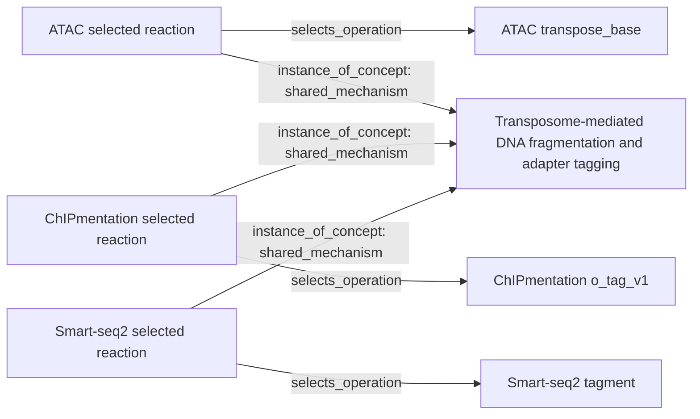

# Can the harness recover a known shared operation?

**Joint curation connected the methods; independently written definitions did not
converge.** This completed diagnostic used ATAC-seq, ChIPmentation and Smart-seq2,
their existing protocol graphs, and registered papers/supplements/kit documentation.
It did not re-extract three complete papers. No production code or scientific
records were changed during the experiment.

The target was coupled DNA fragmentation and sequencing-adapter introduction by
a transposase/transposome. Its context differs across these methods:

| Method | Selected operation | Material being tagged |
|---|---|---|
| ATAC-seq | `transpose_base` | DNA in native chromatin/nuclei |
| ChIPmentation | `o_tag_v1` | Antibody-enriched, bead-bound chromatin |
| Smart-seq2 | `tagment` | Amplified cDNA |

ATAC purification (`purify_base`) was the negative control: handling already
tagged DNA does not make purification the tagging reaction. Expected regions and
source passages were recorded before launch, withheld from agent prompts, and
hashed. No shared category name, definition or membership answer was supplied.
The source references are in the experiment's expectation record: ATAC primary
passages p00004/p00016; ChIPmentation primary p00004/p00016 and supplement p00005;
Smart-seq2 primary p00031 and the contemporaneous Nextera guide p00118.

## Three conditions and their results

All used `gpt-6.1-sol`, `xhigh`, fresh conversations and empty experimental registries.

| Condition | What the agents received | Result | Wall time |
|---|---|---|---|
| Automatic selection, joint curation | Three full extracted workflows and their sources; selector could choose up to six sections | Six sections, three admitted concepts. All three methods share a tagmentation-based **purpose**; ATAC/ChIPmentation also share a qPCR-guided amplification purpose. No isolated shared-reaction membership was produced. | 30m 36s |
| Supplied boundaries, joint curation | Three single-reaction selections plus purification, with their contexts and sources | One independently proposed and reviewed **shared mechanism** connects all three reactions. Purification stays separate. Two concepts, four memberships. | 12m 22s |
| Supplied boundaries, independent workers | Same selections split between three workers using a fresh shared registry | All four source/utility reviews passed. Two definition comparisons remained unresolved; all three jobs were held. Zero admitted concepts/memberships. | 10m 14s |

The independent condition was added after observing the joint-curation success;
it is an exploratory follow-up. The two initial conditions ran concurrently, and
the independent condition overlapped their later stages. These workloads differ,
so the timings are not a controlled speed comparison.

The successful reaction-level graph contains this path for each method:

The selection-to-operation pointers are `selects_operation` edges in the saved
graph. They retain exact operation IDs and workflow/source hashes. Buffers,
conditions, substrates and biological interpretation stay on each use. The
Smart-seq2 mechanism remains explicitly inferred from its named kit documentation.
This graph asserts shared mechanism at that level, not experimental interchangeability
or historical ancestry. The three recovered method pairs are induced by three
memberships in one concept; they are not three added method-to-method ancestry edges.

## What failed, precisely

**Boundary discovery:** the selector included the target reaction in all three
methods, but inside different larger sections (4, 6 and 4 operations). The compiler
recognized the common substep in its prose. Its output contract only allowed
assigning categories to those supplied sections, so it could not submit smaller
matching sections at that stage. Keeping their whole-unit relationship at
`shared_purpose` was appropriate.

**Independent definition reconciliation:** workers proposed “adapter-loaded
transposase,” “Tn5,” and “transposome” definitions with different loading,
integration, fragment-end and information-effect wording. One comparison judged
the Smart-seq2 definition broader than the ChIPmentation definition. Two comparisons
against the ATAC definition were unresolved. The comparison agent was explicitly
restricted to the assertions in those definitions, without source lookup or
rewriting them. It could flag ambiguity but could not clarify it or propose a
shared definition. Cohort-atomic publication also held ATAC's independently
supported cleanup category.

This is not evidence that the underlying reactions lack a common transformation:
the joint condition established a source-reviewed common definition from the same
selections. It exposes the difference between deduplicating existing definitions
and constructing a useful shared abstraction.

The next change to test is a bounded handoff from unresolved comparisons to the
existing joint compiler/reviewer, using the relevant selections and source passages.
That handoff should also allow proposing smaller connected selections. Preserve
original definitions, review the new proposal, and retain unresolved outcomes when
sources cannot support it. Do not simply relax the identity checker or force a
merge. This follow-up is **not implemented or evaluated by this diagnostic**.

## Records and validation

The [machine-readable report](../provenance/shared_known_overlap_20261018.json)
contains definitions, memberships, comparisons, native archive paths, hashes,
tool errors and usage. Its `root` points to the local experiment directory, which
contains the exact prompts, expectations, reproducible drivers, `results.json`,
and separate graph projections for each condition. Cached source papers remain local.

All **16 native sessions** completed in distinct threads. Fourteen proposed
memberships passed source/definition/boundary/usefulness review across the three
conditions; this includes repeated testing of the same selections. There were
15 recovered shell/tool failures and no failed native sessions. The independent
workers performed six unique scope comparisons with no duplicated pair reports.
Graph loading, concept-neighbor traversal and pointers back to original operations
passed for admitted results. No expected-answer filename access was found in the
command audit; this was not an OS-enforced confidentiality test.

These are intentionally chosen, previously used methods and model-reviewed
claims. The result is a diagnostic, not held-out scientific accuracy, expert
validation, or evidence that the full atlas is ready for automatic linking.

## Source-backed recovery of the independent drafts

The follow-up copied the failed independent-worker database and kept the original
experiment unchanged. The compiler received only the original four operation
selections, their sources, the independent draft definitions and their comparison
ambiguities. The successful joint-curation answer and frozen expected relations
were not supplied. There were no paper-specific matching rules.

The new recovery path reopens the sources and can clarify definitions, propose a
shared abstraction, keep separate definitions or remain unresolved. The compiler
proposed a reaction-level class for **coupled transposome fragmentation and adapter
tagging**, with all three tagging operations as members. It preserved DNA origin,
chromatin state, bead support, enzyme/loading evidence, conditions and information
interpretation as use-specific properties. It did not claim that the old definitions
were identical or that the procedures are experimentally interchangeable.
Purification retained a separate purpose-level definition.

| Result | Before recovery | After recovery |
| --- | --- | --- |
| Admitted concepts | 0 | 2 |
| Admitted memberships | 0 | 4 |
| Expected method pairs connected through the shared mechanism | 0 of 3 | 3 of 3 |
| Purification incorrectly linked to the tagging mechanism | 0 | 0 |
| Original drafts and comparison reports | Preserved | Preserved with replacement pointers |

The fresh reviewer approved every membership, all 12 cross-selection boundary
checks, and 27 asserted definition fields. The purification mechanism field was
explicitly unasserted, rather than invented. The final comparison distinguished
purification from tagging. All three old submissions were retired as pending
drafts only after the replacement passed source/utility review; normal publication
then admitted the four new memberships. No previous positive review was inherited.

This recovery took **807.7 seconds (13 minutes 28 seconds)** across three fresh
`gpt-6.1-sol`/`xhigh` sessions: compiler, independent reviewer and definition
comparison. One passage-reader call exceeded its eight-reference limit and was
recovered; no native session failed. The isolated graph has 1,752 nodes and 3,975
edges, including the unchanged base atlas. Lookup, concept-to-selection traversal
and selection-to-original-operation traversal all passed. The old failed database
and all its existing comparison reports were checked unchanged. The command audit
found no expected-answer or successful-control access; it does not prove OS-level
isolation.

The [machine-readable recovery report](../provenance/definition_reconciliation_results.json)
records the actual definitions, memberships, lineage, graph checks, timing and
usage. Its local root contains the exact prompts, source review, comparison and
graph projection. The [design audit](../provenance/definition_reconciliation_design.json)
and [workflow documentation](CONCEPT_REGISTRY.md#reconcile-independent-definitions-from-sources)
explain the general implementation. Ten recovery/orchestration regression tests
pass; the full suite passes 1,038 tests.

This establishes recovery of the recorded failure on these supplied boundaries.
It does not establish optimal operation cuts, performance on unseen families,
expert-confirmed biochemical correctness, or throughput for 201 technologies.
The batch runner now attempts one such recovery for unresolved components wholly
owned by the batch. It does not retry scientific judgments until they agree.
