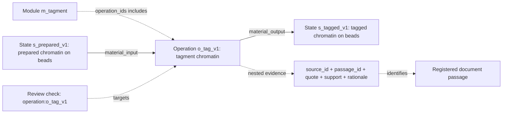

# Extraction output: files, fields and connections

The authoritative scientific extraction is a JSON document. Its sentences are
written by the agent inside named fields. Python creates `protocol.txt` by printing
those existing fields under labels; it does not ask another model to summarize them.

Start with **`overview.html`** to read the structure. It shows Operations and their
typed material/data connections, with recipes and evidence expandable. State labels
link to full descriptions. Modules are optional navigation groups. Large explicit
alternative-input groups are folded for display; their choices and conditions are
retained. No Operations or States are merged by this renderer.

For an existing workflow, create a new reading view without a model call:

```sh
PYTHONPATH=src .venv/bin/python -m genomics_discovery.curation.workflow_extraction overview examples/chipmentation/workflow.json --format html --output /tmp/chipmentation-overview.html
```

Standalone `overview` is explicitly unreviewed. Batch exports include the exact
existing review outcome, adverse checks and omissions; they do not perform a new
review. Nonpositive exports use `overview_diagnostic.*`. A declared empty gap list
does not hide known review corrections or prove completeness. Use `query WORKFLOW
OPERATION_ID` for the full Operation and its connected records.

## Files in a current batch run

The default is one source reader, one extractor and a fresh reviewer. A repair
adds another extractor/reviewer pair. Always use the paths in `state.json` to find
the final artifacts; stage numbers are not a stable API.

| File | Contents / role |
| --- | --- |
| `source_packet.json` | Frozen scope, source identities, original-file hashes and registered passages. |
| `attempts/001_source_obligations/artifact.json` | Source reader's requirements, source scope and missing-evidence judgments, written before seeing an extraction. |
| `attempts/002_integrator/authoring.json` | Compact structured draft; repeated evidence is stored once in a registry. |
| `attempts/002_integrator/artifact.json` | Full workflow, including materialized input/output edges. |
| `attempts/003_reviewer/artifact.json` | Source-review checks of the exact workflow version. |
| `attempts/003_reviewer/source_coverage_review.json` | Where each source requirement is satisfied, missing, partial, uncertain or not applicable. |
| `protocol.txt` | Readable projection of the same workflow and review. |
| `overview.json`, `overview.txt`, `overview.html` | Main structure with exact State/Operation/Flow IDs, links to details, and bound existing review context. Recipes and evidence remain in the workflow. |
| `graph_candidate.json` | Standalone graph projection with source/review records. |
| `state.json`, `config.json` | Stage status, artifact paths, configuration, integrity bindings and usage. |
| Stage `prompt.txt`, `events.jsonl`, `result.json` | Exact instructions, native session events and execution results. |

The distributed ChIPmentation example predates this default. Its separate chemistry
and information readers and their finding-coverage files remain an optional mode;
they are not extra mandatory stages in the current bulk run.

## The complete workflow record

Top-level fields: `format_version`, `method_id`, `title`, `scope`, `variant`,
`states`, `operations`, `flows`, `modules`, `unresolved`, `gap_resolutions`.

| Record | Fields |
| --- | --- |
| State | `id`, `kind` (`material` / `data`), `description`, `evidence` |
| Operation | `id`, `name`, `action`, `inputs` (state IDs), `outputs` (state IDs), `input_bindings`, `output_bindings`, `resources`, `information_effect`, `evidence` |
| Input/output binding, nested in an operation | `state_id`, `basis`, `condition`, `selection` (`required` / `optional` / `alternative`), `alternative_group`, `evidence` |
| Resource, nested in an operation | `kind` (`reagent` / `equipment` / `software` / `condition`), `description`, `evidence` |
| Flow / connection | `id`, `source`, `target`, `kind`, `basis`, `condition`, `evidence`, `association`, `selection`, `alternative_group` |
| Module | `id`, `name`, `operation_ids`, `boundary_rationale` |
| Gap | `id`, `description`, `blocking`, `next_evidence` |
| Gap resolution | `reader_role`, `gap_id`, `rationale`, `evidence` |

An operation describes an action or a grouped set of actions. A state describes
the material/data before or after an action. A module groups operation IDs; it does
not itself perform an additional action. List order is storage order. Flows define
the route. Repeated cycles are presently described inside an action because the
workflow schema requires an acyclic graph.

These are not progressively smaller biochemical levels. The Workflow is the whole
method record; States and Operations describe its graph, Flows connect them, and
Modules group Operations. Resources and evidence are attached records. Future
extraction uses the [consequential-boundary rule](decisions/2026-10-20-workflow-granularity-and-overview.md)
to avoid one-operation-per-motion and repeated recipe prose while preserving
meaningful transformations, branches, identities and compatibility boundaries.

Each operation must belong to exactly one module under the current schema. This is
a representation choice, not a scientific claim about the only valid decomposition.

## One real connection, end to end

From the [ChIPmentation workflow](../examples/chipmentation/workflow.json):



The operation names `s_prepared_v1` in `inputs` and `s_tagged_v1` in `outputs`.
The assembler uses those explicit IDs to make the two edges. In this older example
it copies the operation's evidence onto these mechanical edges. Current extractions
must instead provide an explicit binding for every input and output, with evidence
and a rationale supporting that particular association. The assembler copies those
binding fields to the edge; it does not establish chemical compatibility by
matching similar prose. New source review rejects bare mechanical associations.

Required inputs are cumulative. Members of an `alternative_group` describe
mutually exclusive routes, with conditions explaining the choice. For example,
two alternative washes must not appear as two consecutive required washes.
The conditions are source-qualified text, not executable laboratory instructions.

Edge kinds are `material_input`, `material_output`, `data_input`, `data_output`,
`precedence`, and `control`. The first four connect states and operations. The last
two connect operations; a `control` edge requires a condition.

## Evidence and sources

An evidence record has exactly five fields:

- `source_id`: registered document identifier.
- `passage_id`: passage identifier within that document and packet rendition.
- `quote`: cited text from the passage.
- `support`: the agent's classification, `reported` or `inferred`.
- `rationale`: the agent's explanation of how the passage supports the record.

Evidence records are nested inside states, operations, resources, flows and review
checks. They are not additional experimental actions. The full workflow format
repeats evidence where used. `authoring.json` instead has `record_kind`, `record`
and `evidence_registry` (plus `format_version`); `evidence_refs` are expanded back
into the full format before validation.

A source packet has method/scope metadata, `format_version`, `rendition_version`,
and `sources`. Each source contains `source_id`, `title`, `url`, `role`,
`original_path`, `original_sha256`, `document_identity`, and `passages`.
Passages contain `passage_id`, `locator`, `text`, and rendition notes when present.

The code verifies that a quotation occurs in the cited passage after whitespace
normalization. It does not prove entailment. Evidence attached to an operation is
not an individual citation link for every sentence in `action` or `information_effect`.

## Reader and reviewer records

The current source-reader record has `format_version`, `source_packet_sha256`,
`method_id`, `scope`, `variant`, `source_scope`, `obligations` and `source_limits`.
Each obligation has an ID, a requirement, required/optional/outside-scope status,
an optional condition, a rationale and evidence. Each source limit records what
is missing, its cause and consequence, whether it blocks the scope, the next
evidence to obtain and citations. These are the reader's scientific judgments;
Python only validates their structure and source bindings.

The source-coverage review binds the exact source packet, source-reader record,
workflow and primary review using four hashes. It lists inspected passages and
one check per obligation, with disposition, selected route, workflow targets,
rationale and evidence. Missing required operations cannot pass merely because
the workflow's existing statements have good citations.

The following reader format is used only by the optional specialist mode:

A reader report has `role`, `inspected_passages`, `findings`, and `unresolved`.
Each finding has `id`, `description`, and `evidence`.

A workflow review has `workflow_sha256`, `source_packet_sha256`,
`inspected_passages`, `checks`, `omissions`, and `notes`. Each check has `target_id`,
`verdict`, `rationale`, and `evidence`. The verdict is `supported`, `unsupported`,
or `unresolved`. An omission has `description`, `blocking`, `action`, and `evidence`.
Hashes bind the review to the exact extraction and source packet.

Review targets are states, operations, flows and gap resolutions. Resources are
checked through their containing operation. Modules do not currently receive a
dedicated reviewer verdict. Their boundaries remain curator interpretations.

With finding coverage enabled, `coverage.json` binds the source packet, workflow
and two reader reports and records dispositions for each finding. A disposition
can be `represented` at named targets, `excluded` with a basis, or `scoped_gap`
linked to a workflow gap. The reviewer checks those dispositions in
`coverage_review.json`. This detects lost known findings; it cannot count findings
that every reader missed.

## Text and graph projections

`protocol.txt` prints operation descriptions, resources, state descriptions and
typed `Route` lines. Its current `Step` label means an operation. Numbered output
can interleave alternative branches. Module membership appears in the initial
module list, and evidence `rationale` is omitted. Use the joined example inspector
to view an operation and its module together; JSON retains the complete record.

`graph_candidate.json` has `format_version`, `id`, `status`, `review_outcome`,
`scope`, `workflow_sha256`, `source_packet_sha256`, `workflow`, `review`,
`source_registry`, `nodes`, `edges`, and `module_memberships`.

Combined-atlas admission reads the underlying workflow JSON, review JSON and
source packet named by the completed run. It also checks the runtime/archive and
applicable source-coverage and specialist finding-coverage bindings. It does not parse `protocol.txt` to recover
the graph and does not require the standalone graph export.
