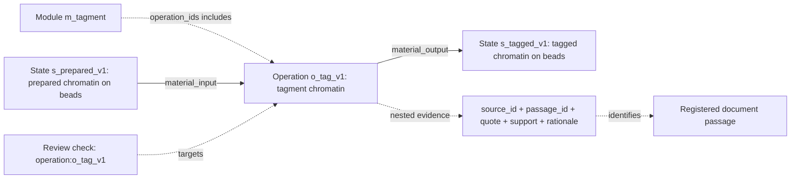

# Extraction output: files, fields and connections

The authoritative scientific extraction is a JSON document. Its sentences are
written by the agent inside named fields. Python creates `protocol.txt` by printing
those existing fields under labels; it does not ask another model to summarize them.

## Files in one run

The numbering below is from the distributed ChIPmentation run. Later repairs create
additional attempt directories; read `state.json` to locate the final artifacts.

| File | Contents / role |
| --- | --- |
| `source_packet.json` | Frozen scope, source identities, original-file hashes and registered passages. |
| `attempts/001_chemistry/artifact.json` | Chemistry reader's findings and gaps. |
| `attempts/002_information/artifact.json` | Information reader's findings and gaps. |
| `attempts/003_integrator/authoring.json` | Compact structured draft; repeated evidence is stored once in a registry. |
| `attempts/003_integrator/artifact.json` | Full workflow, including materialized input/output edges. |
| `attempts/003_integrator/coverage.json` | Where each known reader finding was represented, excluded, or retained as a gap. |
| `attempts/004_reviewer/artifact.json` | Source-review checks of the exact workflow version. |
| `attempts/004_reviewer/coverage_review.json` | Review of the proposed finding dispositions. |
| `protocol.txt` | Readable projection of the same workflow and review. |
| `graph_candidate.json` | Standalone graph projection with source/review records. |
| `state.json`, `config.json` | Stage status, artifact paths, configuration, integrity bindings and usage. |
| Stage `prompt.txt`, `events.jsonl`, `result.json` | Exact instructions, native session events and execution results. |

## The complete workflow record

Top-level fields: `format_version`, `method_id`, `title`, `scope`, `variant`,
`states`, `operations`, `flows`, `modules`, `unresolved`, `gap_resolutions`.

| Record | Fields |
| --- | --- |
| State | `id`, `kind` (`material` / `data`), `description`, `evidence` |
| Operation | `id`, `name`, `action`, `inputs` (state IDs), `outputs` (state IDs), `resources`, `information_effect`, `evidence` |
| Resource, nested in an operation | `kind` (`reagent` / `equipment` / `software` / `condition`), `description`, `evidence` |
| Flow / connection | `id`, `source`, `target`, `kind`, `basis`, `condition`, `evidence` |
| Module | `id`, `name`, `operation_ids`, `boundary_rationale` |
| Gap | `id`, `description`, `blocking`, `next_evidence` |
| Gap resolution | `reader_role`, `gap_id`, `rationale`, `evidence` |

An operation describes an action or a grouped set of actions. A state describes
the material/data before or after an action. A module groups operation IDs; it does
not itself perform an additional action. List order is storage order. Flows define
the route. Repeated cycles are presently described inside an action because the
workflow schema requires an acyclic graph.

Each operation must belong to exactly one module under the current schema. This is
a representation choice, not a scientific claim about the only valid decomposition.

## One real connection, end to end

From the [ChIPmentation workflow](../examples/chipmentation/workflow.json):

The operation names `s_prepared_v1` in `inputs` and `s_tagged_v1` in `outputs`.
The assembler uses those explicit IDs to make the two edges. It copies the
operation's evidence onto these mechanical edges. It does not establish chemical
compatibility by matching similar prose. Source review is still required.

Edge kinds are `material_input`, `material_output`, `data_input`, `data_output`,
`precedence`, and `control`. The first four connect states and operations. The last
two connect operations; a `control` edge requires a condition.

## Evidence and sources

An evidence record has exactly five fields:

- `source_id`: registered document identifier.
- `passage_id`: passage identifier within that document and packet rendition.
- `quote`: cited text from the passage.
- `support`: the agent's classification, `reported` or `inferred`.
- `rationale`: the agent's explanation of how the passage supports the record.

Evidence records are nested inside states, operations, resources, flows and review
checks. They are not additional experimental actions. The full workflow format
repeats evidence where used. `authoring.json` instead has `record_kind`, `record`
and `evidence_registry` (plus `format_version`); `evidence_refs` are expanded back
into the full format before validation.

A source packet has method/scope metadata, `format_version`, `rendition_version`,
and `sources`. Each source contains `source_id`, `title`, `url`, `role`,
`original_path`, `original_sha256`, `document_identity`, and `passages`.
Passages contain `passage_id`, `locator`, `text`, and rendition notes when present.

The code verifies that a quotation occurs in the cited passage after whitespace
normalization. It does not prove entailment. Evidence attached to an operation is
not an individual citation link for every sentence in `action` or `information_effect`.

## Reader and reviewer records

A reader report has `role`, `inspected_passages`, `findings`, and `unresolved`.
Each finding has `id`, `description`, and `evidence`.

A workflow review has `workflow_sha256`, `source_packet_sha256`,
`inspected_passages`, `checks`, `omissions`, and `notes`. Each check has `target_id`,
`verdict`, `rationale`, and `evidence`. The verdict is `supported`, `unsupported`,
or `unresolved`. An omission has `description`, `blocking`, `action`, and `evidence`.
Hashes bind the review to the exact extraction and source packet.

Review targets are states, operations, flows and gap resolutions. Resources are
checked through their containing operation. Modules do not currently receive a
dedicated reviewer verdict. Their boundaries remain curator interpretations.

With finding coverage enabled, `coverage.json` binds the source packet, workflow
and two reader reports and records dispositions for each finding. A disposition
can be `represented` at named targets, `excluded` with a basis, or `scoped_gap`
linked to a workflow gap. The reviewer checks those dispositions in
`coverage_review.json`. This detects lost known findings; it cannot count findings
that every reader missed.

## Text and graph projections

`protocol.txt` prints operation descriptions, resources, state descriptions and
typed `Route` lines. Its current `Step` label means an operation. Numbered output
can interleave alternative branches. Module membership appears in the initial
module list, and evidence `rationale` is omitted. Use the joined example inspector
to view an operation and its module together; JSON retains the complete record.

`graph_candidate.json` has `format_version`, `id`, `status`, `review_outcome`,
`scope`, `workflow_sha256`, `source_packet_sha256`, `workflow`, `review`,
`source_registry`, `nodes`, `edges`, and `module_memberships`.

Combined-atlas admission reads the underlying workflow JSON, review JSON and
source packet named by the completed run. It also checks the runtime/archive and
applicable finding-coverage bindings. It does not parse `protocol.txt` to recover
the graph and does not require the standalone graph export.
