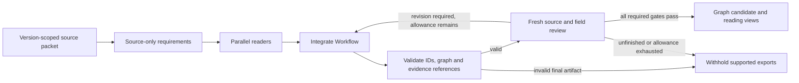

# Working prototype: what to demonstrate

The product is a source-linked description of a published sequencing assay,
represented as a typed method graph and a readable protocol. New assay invention
is a later consumer. A working graph reader does not establish experimental
execution readiness or full scientific correctness.

## Fixed extraction order

The host, rather than the model, controls these stages:



The requirements describe what the sources say must be represented before the
candidate is written. The readers supply observations, not accepted graph edges.
The integrator writes `Workflow` JSON: States describe material/data at a stage;
Operations act on those States; Flows connect their exact IDs. Modules group
Operations for reading and comparison. Python validates this record and generates
the readable exports; it does not write additional scientific claims into them.

One independent reviewer produces the source-coverage and factual-field judgments
in the same attempt. The host checks completeness, current-value bindings and
negative findings before export. These are enforced gates on fallible judgments.
The current repair experiment starts with a preserved Workflow and existing
source requirements, then performs integration and a fresh review. It does not
rerun acquisition or the parallel readers. Adding a reviewed method to a larger
atlas and establishing cross-method scientific relationships are separate stages.

## Three actions to show

1. Open a real method overview. Expand a transformation's material inputs,
   outputs, route conditions, resources and exact evidence. The
   [completed scSTAMP example](../examples/scstamp-seq/README.md) and the
   [ChIPmentation example](../examples/chipmentation/overview.html) are distributed
   in this repository. The scSTAMP example preserves the actual corrected output
   and model-review context from Qiu job 48925060.
2. Query a specific Operation by its exact ID. `query WORKFLOW plate_partition`
   shows the plate split into short spatial products in supernatant and endogenous
   cDNA on beads, along with its exact supporting evidence. Names do not create edges.
3. Attempt a misleading path: `query-path WORKFLOW plate_RNA_library droplet_RNA_FASTQ`.
   The tool returns `needs_route_selection`, exact guarded edge IDs and conditions.
   Sharing the sequencing Operation does not authorize mixing the library routes.

Run these from a checkout with the project environment:

```sh
export PYTHONPATH="$PWD/src"
.venv/bin/python -m genomics_discovery.curation.workflow_extraction query examples/scstamp-seq/workflow.json plate_partition
.venv/bin/python -m genomics_discovery.curation.workflow_extraction audit-boundaries examples/scstamp-seq/workflow.json
.venv/bin/python -m genomics_discovery.curation.workflow_extraction query-path examples/scstamp-seq/workflow.json plate_RNA_library droplet_RNA_FASTQ
```

The last two commands inspect declared topology; they do not reopen papers,
assess chemistry or prove a complete route. Source evidence access uses a separately
registered packet whose original bytes must remain available on Sherlock.

## What is deterministic

The Workflow validator rejects duplicate/dangling IDs, wrong endpoint types,
disagreement between declared inputs/outputs and Flows, mismatched binding
qualifications, multiple producers, cycles and incomplete Module membership.
Hashes bind the source packet, candidate and review to exact recorded contents.
Review coverage must account for every required target/current field group.
An unfinished, stale or negative required review cannot produce a supported export.

`audit-boundaries` enumerates actual external inputs, terminal outputs and isolated
States. An optional exact manifest cannot silently omit or invent one of those
boundaries. The scientific adequacy of the listed starts/ends remains a judgment.
`query-path` never interprets prose conditions as executable guards. Even an
unguarded structural path does not establish that all other prerequisites hold.

## Measured prototype behavior

Qiu job **48925060** completed in **21m30s**: same-source correction, fresh review
and deterministic graph/reading exports. This is repair timing, not fresh
acquisition/extraction timing. The independent review returned `supported` for the
declared general-description scope. The exact diff changes eleven existing
records, preserving graph topology, all Modules and all unresolved records.

Both eight-case local diagnostics rejected four negative controls and retained
four supported controls, with no abstentions. The longer contract did not improve
this small ceiling result. Qiu job **48926094** then challenged the actual
production reviewer with one full Workflow containing three seeded defects. It
identified unsupported disposal, reversed read assignments and a deleted required
partition, returned `needs_revision`, and withheld supported exports. Its runtime
was **15m06s**. Diagnostic exports remain explicitly separate from supported ones.

These are source-checked development cases, not an untouched-family evaluation.
They establish the observed detections, not a general accuracy percentage. The
[experiment report](../experiments/scstamp_seq_20261021/README.md) links the actual
results and independent audits. The canonical atlas was not changed.

## What still needs measurement

Actual source support, necessary-but-omitted operations, correct applicability and
useful cross-method correspondences remain scientific judgments. The current
[eight-case diagnostic](../experiments/scstamp_seq_20261021/verification_controls/README.md)
tests false support and omission detection separately from positive retention.
Its labels received independent source checking, but they are not expert gold or
an estimate of whole-paper accuracy.

The [Qiu plan](../experiments/scstamp_seq_20261021/prototype_plan.json) binds the
same-source repair and small diagnostic. The
[separate full-review plan](../experiments/scstamp_seq_20261021/full_review_probe_plan.json)
binds the seeded challenge; expected findings were not passed to the reviewer.
These completed checks do not yet validate bulk extraction, globally consistent
route execution or cross-method shared-component matching.

The preserved [targeted audit](../experiments/scstamp_seq_20261021/targeted_scientific_audit.json)
records a product-description ambiguity, demonstration-scope clarification and
route-query limitation. It also groups the overlapping source gaps. Missing
execution details are not silently supplied, and a matching quotation is not
treated as proof of its interpretation.
