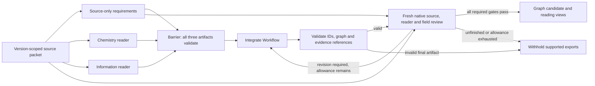

# Working prototype: what to demonstrate

The product is a source-linked description of a published sequencing assay,
represented as a typed method graph and a readable protocol. New assay invention
is a later consumer. A working graph reader does not establish experimental
execution readiness or full scientific correctness.

The completed [source-only run](../provenance/experiments/clean_extraction_20261022/README.md)
is the current end-to-end test. Qiu CPU job **48932552** supplied registered source
packets, without previous graphs, reviews or host correction answers. Its own
reviewer could request one correction.

| Method | Native outcome | Wall time | What happened |
| --- | --- | --- | --- |
| scSTAMP | `supported` after one correction | 108m52s | Source-attribution and coverage-accounting errors were corrected; final review and export gates passed. |
| DBiT | `needs_revision`; supported exports withheld | 87m56s | Final review caught an unchanged optional-image timing/input mismatch missed by the first review; the correction allowance was exhausted. |

These are two development cases, not a whole-atlas accuracy result. The older
[distributed scSTAMP example](../examples/scstamp-seq/README.md) used supplied
source-backed repair feedback and remains a separate demonstration.

## Fixed extraction order

The host, rather than the model, controls these stages:



The three preparation passes run concurrently in the current fresh-specialist
path. The completed baseline ran source requirements first, then its two readers;
the scheduling change is evaluated separately. Each pass uses a fresh session.
The source requirements are candidate-blind and frozen before integration; the
readers do not receive that ledger. All three artifacts must validate before the
integrator starts. Their scientific content is still fallible.

The requirements describe what their author judges necessary from the sources.
The readers supply observations, not accepted graph edges.
The integrator writes `Workflow` JSON: States describe material/data at a stage;
Operations act on those States; Flows connect their exact IDs. Modules group
Operations for reading and comparison. Python validates this record and generates
the readable exports; it does not write additional scientific claims into them.

The reviewer reopens the frozen sources; reader findings and requirements remain
unaccepted claims to check. One independent reviewer produces the primary review,
reader-finding coverage, source coverage and factual-field judgments in the same
attempt. The host checks
required judgment coverage, exact current-value bindings and negative findings
before export. It can enforce those declarations; it cannot prove the judgments
true. Adding a supported method to an atlas and establishing cross-method
scientific relationships remain separate stages.

## Three actions to show

1. Inspect the actual source-only scSTAMP Workflow at the local path below. Its
   final graph contains 67 Operations, 79 States, 169 Flows and 12 Modules. For a
   checkout without the local run archive, the older
   [scSTAMP overview](../examples/scstamp-seq/overview.html) and
   [ChIPmentation overview](../examples/chipmentation/overview.html) are bundled.
2. Query `plate_fractionate`. It shows the plate spatial/endogenous separation,
   its exact material States, resources, Modules and source evidence. The
   descriptions come from the pinned Workflow; names do not create connections.
3. Query the guarded `make_roi` → `encode_single` path. It returns
   `needs_route_selection` with the actual edge conditions. The tool does not
   silently select optional targeted illumination.

Run these from a checkout with the project environment:

```sh
export PYTHONPATH="$PWD/src"
atlas_workflow="provenance/experiments/clean_extraction_20261022/outputs/job_48932552/scstamp/006_integrator/artifact.json"
.venv/bin/python -m genomics_discovery.curation.workflow_extraction query "$atlas_workflow" plate_fractionate
.venv/bin/python -m genomics_discovery.curation.workflow_extraction audit-boundaries "$atlas_workflow"
.venv/bin/python -m genomics_discovery.curation.workflow_extraction query-path "$atlas_workflow" make_roi encode_single
```

The run archive path is available in the research workspace, not bundled with a
fresh clone. The last two commands inspect declared topology; they do not reopen
papers, assess chemistry or prove a complete route. Source evidence access uses
a separately registered packet whose original bytes must remain available on Sherlock.

## What is deterministic

The Workflow validator rejects duplicate/dangling IDs, wrong endpoint types,
disagreement between declared inputs/outputs and Flows, mismatched binding
qualifications, multiple producers, cycles and incomplete Module membership.
Hashes bind the source packet, candidate and review to exact recorded contents.
Review coverage must account for every required target/current field group.
An unfinished, stale or negative required review cannot produce a supported export.

`audit-boundaries` enumerates actual external inputs, terminal outputs and isolated
States. An optional exact manifest cannot silently omit or invent one of those
boundaries. The scientific adequacy of the listed starts/ends remains a judgment.
`query-path` never interprets prose conditions as executable guards. Even an
unguarded structural path does not establish that all other prerequisites hold.

## Measured prototype behavior

The source-only scSTAMP completion audit verified 59 local input/artifact/archive
hashes and four copied complete native archives. Protocol text and overview
JSON/text/HTML regenerate to the final state's exact export hashes. All 67
Operation queries, 169 rendered edges and 271 guarded-path checks passed. Thirteen
nonblocking gap records and the optional characterization advisory remain visible;
they do not make missing sequences or delegated recipes known.

The corresponding DBiT audit preserves the first review's miss and final review's
catch. A correct post-B imaging subroute did not justify the broader first-flow
input association asserted by the same record. Structural validation and source
fact coverage alone could not catch that semantic inconsistency.

Local audit receipts are under
`provenance/experiments/clean_extraction_20261022/host_cases/`:
`scstamp_source_only_completion_audit.json` and `dbit_revised_candidate_audit.json`.
They are finite model/engineering audits, not human expert gold. The
[status record](STATUS.md) tracks frozen gate replay and subsequent experiments.

### Older repaired example and reviewer controls

Qiu job **48925060** completed in **21m30s**: same-source correction, fresh review
and deterministic graph/reading exports. This is repair timing, not fresh
acquisition/extraction timing. The independent review returned `supported` for the
declared general-description scope. The exact diff changes eleven existing
records, preserving graph topology, all Modules and all unresolved records.

Both eight-case local diagnostics rejected four negative controls and retained
four supported controls, with no abstentions. The longer contract did not improve
this small ceiling result. Qiu job **48926094** then challenged the actual
production reviewer with one full Workflow containing three seeded defects. It
identified unsupported disposal, reversed read assignments and a deleted required
partition, returned `needs_revision`, and withheld supported exports. Its runtime
was **15m06s**. Diagnostic exports remain explicitly separate from supported ones.

These are source-checked development cases, not an untouched-family evaluation.
They establish the observed detections, not a general accuracy percentage. The
[experiment report](../experiments/scstamp_seq_20261021/README.md) links the actual
results and independent audits. The canonical atlas was not changed.

## What still needs measurement

Current development overlaps the three independent source passes. The joint
interface-review prompt in **`4fd13da`** is under evaluation; no measured prompt
improvement is claimed. The custody adapter **`90934f7`** passed **2,485 software
tests, three skipped**, independently of native scientific outcomes. Other runs
remain pending. These changes are not substituted beneath completed frozen jobs.

Actual source support, necessary-but-omitted operations, correct applicability and
useful cross-method correspondences remain scientific judgments. The current
[eight-case diagnostic](../experiments/scstamp_seq_20261021/verification_controls/README.md)
tests false support and omission detection separately from positive retention.
Its labels received independent source checking, but they are not expert gold or
an estimate of whole-paper accuracy.

The [Qiu plan](../experiments/scstamp_seq_20261021/prototype_plan.json) binds the
same-source repair and small diagnostic. The
[separate full-review plan](../experiments/scstamp_seq_20261021/full_review_probe_plan.json)
binds the seeded challenge; expected findings were not passed to the reviewer.
These completed checks do not yet validate bulk extraction, globally consistent
route execution or cross-method shared-component matching.

The preserved [targeted audit](../experiments/scstamp_seq_20261021/targeted_scientific_audit.json)
records a product-description ambiguity, demonstration-scope clarification and
route-query limitation. It also groups the overlapping source gaps. Missing
execution details are not silently supplied, and a matching quotation is not
treated as proof of its interpretation.
