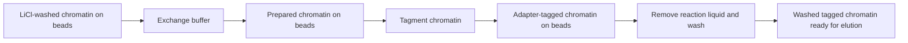

# ChIPmentation: one archived extraction

This is a real saved model extraction and separate source review of the original
ChIPmentation method. It contains **47 operations, 56 states, 7 modules and 111
flows**, plus **13 retained gaps**. Counts include alternative branches and
computational processing; they are not 47 consecutive laboratory actions.

| File | How to read it |
| --- | --- |
| [overview.html](overview.html) | Main reading view: Operations, qualified connections and expandable recipes/evidence. Open this local file in a browser. |
| [overview.json](overview.json), [overview.txt](overview.txt) | The same declared structure, with State descriptions once and links to full records. |
| [workflow.json](workflow.json) | Complete scientific record, including module membership, typed flows and nested evidence rationales. |
| [review.json](review.json) | Separate record-by-record review bound to the workflow/source-packet hashes. |
| [protocol.txt](protocol.txt) | Original text projection; `Step` means operation. Alternatives can interleave in the numbered display. |
| [sources.json](sources.json) | Source identities, URLs and original hashes; not the full source packet. |
| [manifest.json](manifest.json) | Distributed file hashes and reproducibility boundary. |

From the repository root:

```sh
export PYTHONPATH="$PWD/src"
uv run python scripts/check_example.py
uv run python scripts/inspect_example.py --operation o_tag_v1
uv run python scripts/inspect_example.py --operation o_shift --json
```

The inspector displays module membership beside the chosen operation and labels
every endpoint by type, ID and description. It uses the existing query function;
it does not ask a model to interpret the output again.



These three operations are the version-1 route within module `m_tagment`.
`v1`, `v2` and `v3` refer to the authors' alternative ChIP recipes; they are not
agent revisions. The underlying graph retains state and operation nodes separately.

The distributed workflow/review are preserved as archived. The offline check
confirms structure, record references, file integrity and the review's workflow
fingerprint. Full source revalidation and original-run admission require the
registered source packet, originals and native archives in the research workspace.
The existing model verdict is not an independent human verification.

The overview files are new deterministic projections of the unchanged archived
workflow and review. Their [separate receipt](overview_manifest.json) records input,
renderer and output hashes; the historical manifest and original files remain
unchanged. The overview does not re-extract, merge or independently verify content.
