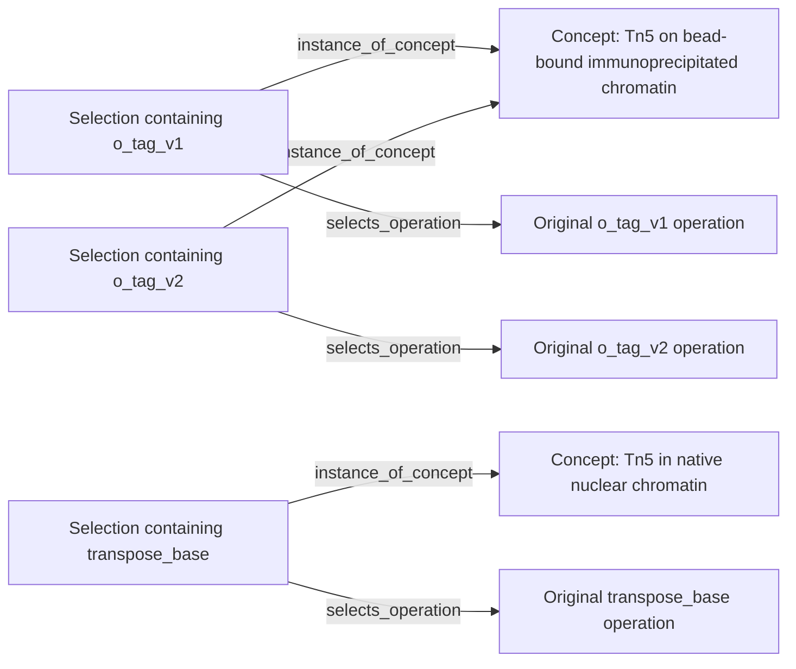

# Three live label assignments

On 2026-10-16, three jobs ran with `gpt-6.1-sol`, `xhigh`. Each job used a compiler
and a separate fresh source reviewer. The jobs started from existing protocol
extractions, not raw papers. All three proposed assignments passed review and the
host's source/binding checks.

| Selected operation | Decision | Stored label | Compiler + review time |
| --- | --- | --- | --- |
| ChIPmentation `o_tag_v1` | Create | Tn5 tagmentation of bead-bound immunoprecipitated chromatin | 7.32 min |
| ATAC-seq `transpose_base` | Create a different definition | Tn5 tagmentation of native nuclear chromatin for accessibility profiling | 6.41 min |
| ChIPmentation `o_tag_v2` | Reuse the first definition unchanged | Tn5 tagmentation of bead-bound immunoprecipitated chromatin | 7.06 min |

The ATAC-seq compiler found the first definition but did not reuse it: that
definition explicitly requires antibody-enriched chromatin on beads. The third
compiler reused it because the selected ChIPmentation transformation still met
the definition; surrounding wash differences remained in the individual workflow.

This is what the graph records:



Original workflow operations, their inputs/outputs and their local module
memberships remain unchanged. An indexing definition can eventually have several
operation groups as instances; it is not itself a replacement protocol.

## Inspect the outputs

- [catalogue.json](catalogue.json) contains the two actual model-authored definitions.
  Read `substrate`, `operation`, `output`, `information_effect`,
  `context_requirements` and `scope_note` together to understand a label.
- [pilot_results.json](pilot_results.json) contains decisions, explanations,
  source identities and inspected passage IDs, artifact hashes, timings and usage.
  Full source packets and native transcripts remain in the local research archive.

Search the real catalogue without a model or a database:

```sh
export PYTHONPATH="$PWD/src"
uv run atlas-concepts lookup examples/concept_registry/catalogue.json 'Tn5 chromatin'
uv run atlas-concepts inspect examples/concept_registry/catalogue.json \
  tn5_tagmentation_of_bead_bound_immunoprecipitated_chromatin
```

The local atlas projection contains two concept nodes, three selections and six
new edges. Lookup, assignment inspection, concept neighbors and navigation back
to the original operations were exercised against that assembled graph. The
[registry guide](../../docs/CONCEPT_REGISTRY.md) gives the complete tool sequence.

## What this does and does not test

The pilot exercises creation, a context distinction, reuse, fresh review and graph
integration. It does not estimate correctness, retrieval recall or whether these
are the most useful boundaries. The examples are closely related and all three
selections contain one operation. Multi-operation selections and multiple labels
per selection have software tests, but were not part of this live pilot.

In particular, these two definitions do **not** create a broader shared Tn5 concept.
That remains a separate, evidence-reviewed abstraction decision. Existing
cross-protocol comparisons can describe partial overlap without merging these
definitions. We have not changed the prompt to force these examples together.

After the pilot, two `commit_base_revision` metadata values were corrected with
a backup and correction ledger; scientific proposals, occurrences and reviews
were unchanged. General integrity, pagination and archive-binding improvements
were tested offline. The report distinguishes these checks from the earlier live
model executions. No full-atlas batch was launched.
